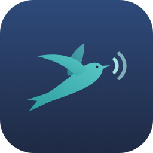

# LarkGateway

**Want a script or program on your own computer to run when something happens in Lark?**
Someone edits a field in a Base, sends your bot a message, drops a file in a chat. This is
the thing for it.

```
   Lark (cloud)                          Your computer
 ┌───────────────────┐               ┌──────────────────────────────┐
 │ a field is edited │               │  LarkGateway                 │
 │ a message arrives │ ───────────►  │   "a file arrived in chat X" │
 │ a file is posted  │   instantly   │      → runs import_file.py   │
 └───────────────────┘               │   "row changed in Base Y"    │
                                     │      → runs update_stock.bat │
                                     └──────────────────────────────┘
```

Some things people use it for:

- A colleague sends the bot a bank statement → your script imports it into your accounting
  system and replies "done, 42 lines imported".
- Someone ticks "Approve" on a row in a Lark Base → your program generates the PDF and sends it.
- A customer table in a Base is edited → your server refreshes its own copy straight away,
  instead of re-reading the whole table every few minutes.

You don't need a public web address, a cloud server or any programming in Go. You write a
small rules file: *"when this happens, run that"*, and your script can be anything that runs
on your computer: Python, PowerShell, a `.bat` file, an `.exe`. LarkGateway hands it the
details of what happened.

If your script crashes, the computer restarts or the internet drops for an hour, nothing is
lost: every event is saved to disk first, retried if it fails, and anything missed while
offline is caught up when the connection comes back.

## How it works, in one paragraph

LarkGateway is a small Go service. It keeps one live connection open to Lark for each of
your Lark apps (bots), using Lark's own "persistent connection" mode, so Lark pushes events
to you the moment they happen; your computer only makes an outgoing connection, like a
browser does. For each event, your rules (`gateway.toml`) decide which command to run, and
the event's details arrive on that command's input as JSON. LarkGateway itself makes no
business decisions: what an event *means* is your script's job.

> Provided as-is. We run it in production for our own Lark apps and maintain it for that
> use. Issues and pull requests are welcome, but there is no promise of support.

## Why it exists

You have a few programs on one machine (an office server, say) that must react to Lark
within seconds: a file sent to a bot, a box ticked in a Base. Lark gives each event to only
**one** of an app's open connections, chosen at random, so two programs listening for the
same app each silently miss events. You need exactly one listener per app, it has to run
your programs, and it must not lose anything.

The longer answer, including "can't I just use X?", is in [docs/WHY.md](docs/WHY.md).

## What it guarantees

1. **Saved before acknowledged.** Each event is written to `spool/<route>/pending` before
   Lark is told it arrived. A crash, restart or failing command never loses it.
2. **One at a time, retried.** A route handles one event at a time, oldest first. A failure
   (any non-zero exit) is retried after 1, 5, then 15 minutes, up to the route's `retries`
   (default 3); after the last try the event moves
   to `spool/<route>/failed` and an alert is posted to a Lark chat. Successful events move to
   `spool/<route>/done` and are kept 14 days.
3. **Catch-up after every reconnect.** Lark does not replay events missed while you were
   offline. After every connect and reconnect, each route's `catchup` command runs so your
   program can look for what it missed.
4. **Duplicates ignored.** A redelivered event (same event id) is dropped.
5. **Scheduled runs.** A route may have a `tick` that runs on a timer. The command can say
   when it is next needed by writing an RFC 3339 time (or `none`) to the file named in
   `GATEWAY_NEXT_RUN_FILE`, within `tick.every` and `tick.max_wait`.
6. **One copy per machine.** A second copy refuses to start. **Never run the same Lark app
   on two machines**: Lark splits events between connections, so each would miss some.
7. **Least privilege.** Each command sees only the `.env` keys its route lists, plus the
   app's credentials if the route asks for them.

## Quick start

1. **In the Lark developer console**, for your app:
   - Events & Callbacks → subscription mode **"Receive events through persistent connection"**.
   - Add the events you need (e.g. `im.message.receive_v1`, `drive.file.bitable_record_changed_v1`)
     and the scopes they require. For Base record changes, read the next section first.
   - Publish a version of the app.
2. **Build** (Go 1.27 or later):
   ```
   go build -o lark-gateway.exe .
   ```
3. **Configure.** Copy `gateway.example.toml` to `gateway.toml` and fill in your app id,
   alert chat and routes. Put secrets in `.env` beside it, never in the TOML:
   ```
   MYBOT_APP_SECRET=...
   ```
4. **Check, then run:**
   ```
   lark-gateway.exe -check         # validates config, .env, commands and folders
   lark-gateway.exe -test-alert    # posts a test message to the alert chat
   lark-gateway.exe                # runs in the foreground; Ctrl+C stops it cleanly
   ```
5. **As a Windows service:** `install.ps1` (run as administrator) installs it with
   [NSSM](https://nssm.cc/) and refuses to change anything if `-check` fails. To update just
   the program, `tools/swap-exe.cmd` checks the new build, keeps the old one and restarts.
   On Linux, build normally and run it under systemd; this is untested by us.

Tip: start a new app with a route that runs `tools/probe.py`. It records exactly what Lark
sends, so you can write the real handler against real events.

## Base record changes: the scope Lark doesn't document

To receive `drive.file.bitable_record_changed_v1` for a Base, the app needs:

- the event added in the console (persistent connection), and `docs:event:subscribe`;
- **`bitable:app` granted as a *user* scope as well as a tenant scope.** With the tenant
  scope alone, subscribing succeeds and everything looks right, but Lark pushes no events at
  all. We narrowed this down by removing scopes one at a time on a test app;
- edit access ("Can manage") on the Base;
- the Base token listed in `subscribe_bitable` on the app. The gateway asks Lark for that
  Base's changes on every connect and keeps retrying each minute until Lark agrees (just
  after a power cut, the network may not be up yet). The health page shows `subscribed`.

## What your command receives

- **stdin:** the event JSON (for `event` runs).
- **Environment:** `GATEWAY_ROUTE`, `GATEWAY_APP`, `GATEWAY_REASON` (`event`, `catchup` or
  `tick`), `GATEWAY_EVENT_TYPE`, `GATEWAY_EVENT_ID`, `GATEWAY_LARK_DOMAIN`, the `.env` keys
  listed in the route's `env`, and with `pass_app_credentials = true` also
  `GATEWAY_LARK_APP_ID` and `GATEWAY_LARK_APP_SECRET`. On a route with a tick, every run also
  gets `GATEWAY_NEXT_RUN_FILE`.
- **Exit code:** 0 = done; anything else = failed, retry.

## Is it healthy?

- `http://127.0.0.1:8791/` shows each app (`connected`, last event, `subscribed` Bases) and
  each route (last success, last failure, `pending`, `next_tick`). The same is written to
  `state/health.json` every 30 seconds. Point your uptime monitor at it to catch the
  gateway itself stopping.
- Problems post themselves to the alert chat: an app disconnected for over 5 minutes, a Base
  subscription still failing after 5 minutes, an event that failed all its retries, a failed
  catch-up or scheduled run.
- Logs: `logs/gateway.log`, one JSON line per entry.
- To re-run a failed event, move its file from `spool/<route>/failed` back to `pending`.

## Configuration reference

See `gateway.example.toml`; every key is commented there. Validate after any edit with
`-check`.

## Built on

The Lark connection is Lark's official Go SDK
([`larksuite/oapi-sdk-go`](https://github.com/larksuite/oapi-sdk-go)). This project adds the
safety layer around it: save first, one at a time per route, retries, catch-up, duplicate
suppression, per-route environment, health page and alerts. About 1,700 lines of Go, with
tests (`go test ./...`).

## Licence

MIT, see [LICENSE](LICENSE).
